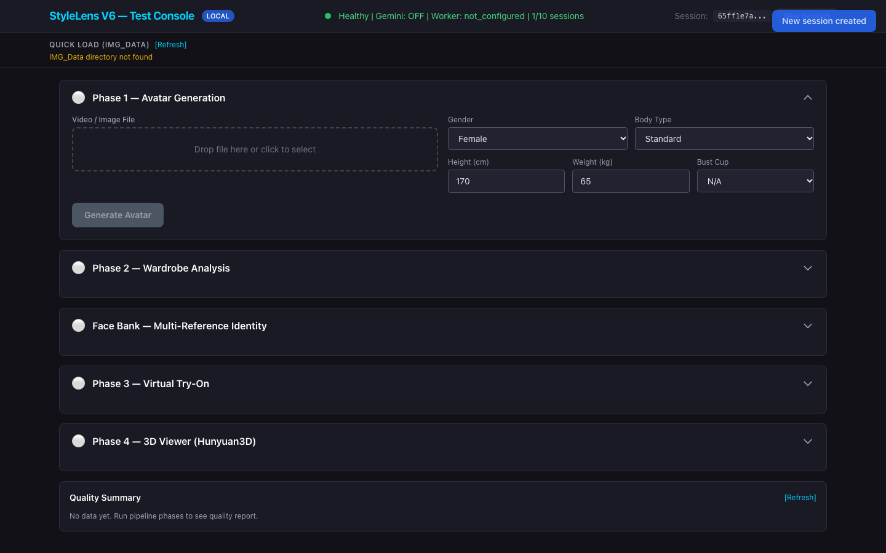
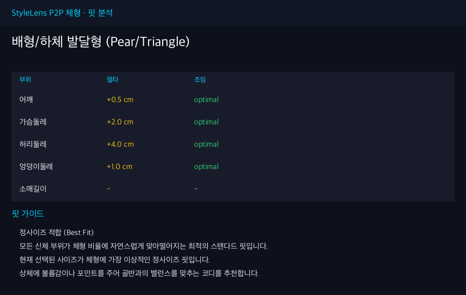
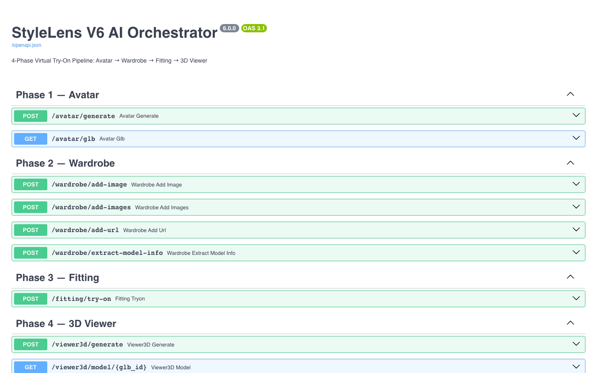

<h1 align="center">$\bf{\large{\color{#6580DD} StyleLens AI Server }}$</h1>

**사진과 체형 정보로 3D 아바타를 만들고, 고른 옷을 8개 각도로 입혀 보여 주는 가상 피팅 AI 서버입니다.**

신체 치수와 옷 치수의 차이를 부위별로 계산해 핏을 진단하고, 그 결과를 피팅 이미지 생성에도 반영합니다. 전체 파이프라인은 FastAPI 오케스트레이터가 조율하며, GPU가 필요한 모델은 원격 워커로 분리해 GPU가 없을 때도 CPU만으로 서버가 동작합니다.



<hr>

## 개발 환경

### Language


### Framework & Runtime


### AI & Model


### Infra


<hr>

## 주요 기능

### 1. 3D 아바타 생성
- 영상이나 사진에서 사람을 찾고(YOLO), SAM 3D Body로 3D 바디 메쉬를 복원해 GLB로 내보냅니다.
- 키, 몸무게, 컵 사이즈로 BMI와 가슴 볼륨을 계산해 메쉬 단면에 반영합니다.
- 0°부터 315°까지 45도 간격 8개 각도를 CPU 소프트웨어 렌더러로 그립니다. 자세 보정, 팔 접기, 다리 모으기를 렌더 전에 적용합니다.

### 2. 의류 분석
- SAM3로 옷 영역을 분리하고, FASHN 파서로 18개 부위(상의, 하의, 팔, 다리 등)를 나눕니다.
- Gemini가 색상, 소재, 핏, 넥라인, 신축성 같은 속성을 뽑습니다. 여러 장을 올리면 정면, 측면, 디테일 사진을 우선순위로 합칩니다.
- 사이즈표에서 가슴·허리·엉덩이 값이 단면(반둘레)인지 판정해 둘레로 바꿉니다.

### 3. 8각도 가상 피팅
- CatVTON-FLUX 또는 FASHN VTON으로 각도마다 옷을 입힙니다. 사용할 수 없으면 Gemini 이미지 생성으로 넘어갑니다.
- 핏 진단 결과에 따라 옷 마스크를 넓히거나 줄여, 큰 옷은 여유 있게, 작은 옷은 붙게 그립니다.
- 얼굴 사진을 최대 11장 받아 Face Bank를 만들고, 각도에 맞는 얼굴을 골라 InsightFace로 얼굴을 일관되게 유지합니다.

### 4. P2P 핏 진단
- 어깨, 가슴, 허리, 엉덩이, 소매의 `옷 치수 - 신체 치수`를 계산해 5단계 조임도로 분류합니다.
- 허리·엉덩이 비율과 가슴·허리 비율로 체형을 5가지(모래시계형, 사과형, 배형, 역삼각형, 직사각형)로 나눕니다.
- 부위별 진단, 사이즈 업·다운 권장, 체형별 코디 팁을 한국어 리포트로 돌려줍니다.

### 5. 3D 뷰어와 실시간 진행률
- 피팅 결과로 Hunyuan3D GLB를 만들고, 웹 콘솔의 Three.js 뷰어에서 돌려 볼 수 있습니다.
- 각 단계의 진행률을 WebSocket과 SSE로 실시간 전송합니다.

<hr>

## 아키텍처

```
Web Console (HTML + Three.js)
        │  REST / WebSocket / SSE
        ▼
FastAPI Orchestrator (CPU)
  ├─ 세션 관리, 진행률 브로드캐스트
  ├─ 메쉬 렌더링, GLB 패킹, P2P 핏 진단
  └─ Gemini 의류·체형 분석
        │  GPU 작업만 위임 (실패 시 로컬 실행)
        ▼
GPU Worker (Modal 서버리스)
  └─ YOLO, SAM 3D Body, SAM3, FASHN, SDXL, FASHN VTON, InsightFace, Hunyuan3D
```

| 단계 | 하는 일 | 주요 모델 |
|---|---|---|
| Phase 1 Avatar | 사람 검출, 3D 메쉬 복원, 8각도 렌더 | YOLO, SAM 3D Body |
| Phase 2 Wardrobe | 옷 분리, 부위 파싱, 속성 분석 | SAM3, FASHN Parser, Gemini |
| Phase 3 Fitting | 8각도 가상 착용, 얼굴 유지 | CatVTON-FLUX / FASHN VTON, InsightFace |
| Phase 4 3D Viewer | 피팅 결과로 3D 모델 생성 | Hunyuan3D |
| P2P | 치수 차이 계산, 체형 분류, 핏 리포트 | 규칙 엔진 + Gemini 앙상블 |

<hr>

## P2P 핏 진단



신체 치수는 직접 입력한 값을 먼저 쓰고, 없으면 키와 몸무게로 추정합니다. 옷 치수는 사이즈표, 피팅 모델 정보, 카테고리별 기본값 순서로 찾습니다.

| 조임도 | 기준 (옷 - 몸) |
|---|---|
| critical_tight | -5cm 미만 |
| tight | -5cm 이상 -2cm 미만 |
| optimal | -2cm 이상 +5cm 미만 |
| loose | +5cm 이상 +10cm 미만 |
| very_loose | +10cm 이상 |

<hr>

## API

| 메서드 | 경로 | 설명 |
|---|---|---|
| POST | `/avatar/generate` | 영상·사진과 체형 정보로 아바타 생성 |
| POST | `/wardrobe/add-images` | 옷 사진, 사이즈표, 상품 정보 분석 |
| POST | `/face-bank/upload` | 얼굴 참조 사진 등록 |
| POST | `/fitting/try-on` | 8각도 가상 피팅 |
| POST | `/p2p/analyze` | 핏 진단과 한국어 리포트 |
| POST | `/viewer3d/generate` | 3D GLB 생성 |
| WS | `/ws/progress/{session_id}` | 실시간 진행률 |

전체 명세는 서버 실행 후 `/docs`에서 볼 수 있습니다.



<hr>

## 설치 및 실행

```bash
cd ai-service
python3 -m venv .venv
source .venv/bin/activate
pip install -r requirements.txt

cp .env.example .env   # Gemini API 키 설정 (선택)
python -m orchestrator.main
```

| 주소 | 내용 |
|---|---|
| `http://localhost:8000/ui` | 테스트 콘솔 |
| `http://localhost:8000/docs` | API 문서 |
| `http://localhost:8000/health` | 상태 확인 |

GPU 모델(PyTorch, diffusers, InsightFace 등)은 `requirements.txt`에 주석으로 남겨 두었습니다. 설치하지 않으면 해당 단계는 대체 경로로 동작합니다.

### 테스트

```bash
pytest tests/ -v   # 237개
```

<hr>

## 디렉토리 구조

```
ai-service/
├── orchestrator/   FastAPI 진입점, 세션, 직렬화, 워커 클라이언트, 라우터
├── core/           아바타, 의류, 피팅, 3D, P2P, Face Bank 파이프라인
├── static/         테스트 콘솔 (Three.js 뷰어 포함)
├── tests/          단위·통합 테스트
└── docs/           파이프라인, API, 모델 명세
```
