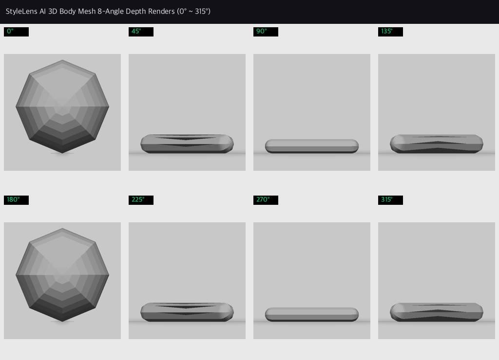
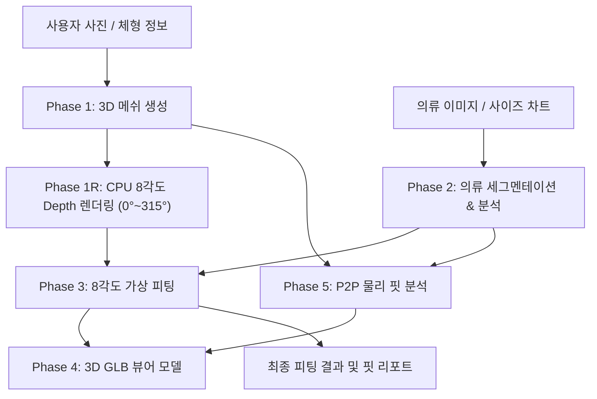

# StyleLens AI FastAPI Server — 360도 가상 피팅 & 3D 체형 분석 시스템

사용자 사진 한 장에서 3D 바디 메쉬를 복원하고, 8개 각도(0°~315°)의 가상 피팅 및 물리 기반 핏(P2P, Physics-to-Prompt) 분석을 제공하는 고성능 AI FastAPI 서버이다.
CPU 기반 독립 실행(Standalone) 및 실시간 WebSocket 진행률 스트리밍을 지원한다.

---

## 주요 화면 및 결과물

### 1. 테스트 콘솔 웹 UI (`/ui`)
브라우저에서 직접 아바타 생성, 의류 분석, 8각도 피팅, 3D 뷰어, P2P 핏 분석을 단계별로 테스트할 수 있는 대화형 콘솔이다.


### 2. FastAPI 대화형 API 문서 (`/docs`)
Swagger UI를 통해 모든 엔드포인트의 입출력 스펙과 실시간 테스트를 지원한다.


### 3. 3D 바디 메쉬 8각도 렌더링 (0° ~ 315°)
사용자의 신체 메타데이터(키, 몸무게, 컵 사이즈, 체형)를 반영하여 CPU 소프트웨어 렌더러로 생성한 8개 각도의 Depth 맵과 3D GLB 아바타 메쉬이다.



### 4. P2P (Physics-to-Prompt) 신체 치수 핏 진단 및 체형 분석
사용자가 직접 입력하거나 자동 추정된 신체 치수(어깨, 가슴, 허리, 엉덩이)와 의류 실측 치수 간의 물리적 델타를 계산하여, 5대 체형(Hourglass, Apple, Pear, Inverted Triangle, Rectangle) 자동 분류, 부위별 조임도(Tightness), 한글 맞춤 핏 총평, 사이즈 업/다운 권장 가이드, 스타일링 팁을 도출한다.


---

## 시스템 아키텍처

```
Frontend (React 19 + Three.js)
    │
    ▼ (REST / WebSocket)
FastAPI Orchestrator (CPU / PyTorch / Trimesh)
    ├── Phase 1: 아바타 생성 (3D 메쉬 복원 & 8각도 렌더링, GLB 생성)
    ├── Phase 2: 의류 분석 (SAM3 마스킹 & FASHN 파싱)
    ├── Phase 3: 가상 피팅 (8각도 착용 시각화)
    ├── Phase 4: 3D 뷰어 (Trimesh 3D GLB 내보내기)
    ├── Phase 5: P2P 물리 기반 핏 분석 엔진
    └── WebSocket: 실시간 파이프라인 진행률 스트리밍 (/ws/progress)
```

---

## 파이프라인 흐름



| Phase | 설명 | 세부 구현 |
|-------|------|----------|
| **Phase 1: Avatar** | 사용자 신체 스펙 반영 3D 메쉬 복원 | Trimesh + 체형 변형(컵 사이즈, 어깨 보정) |
| **Phase 1R: Render** | 8개 각도 소프트웨어 렌더링 | NumPy 기반 CPU Depth 렌더러 (0° ~ 315°) |
| **Phase 2: Wardrobe** | 의류 마스크 및 카테고리/소재 분석 | SAM3 분할 + FASHN 파싱 (휴리스틱 Fallback 지원) |
| **Phase 3: Fitting** | 8각도 가상 피팅 이미지 생성 | 8각도 실루엣 정합 및 착용 시각화 |
| **Phase 4: Viewer3D** | 3D 웹 뷰어용 바이너리 생성 | 표준 GLTF/GLB 포맷 바이너리 다운로드 |
| **Phase 5: P2P Engine** | 물리 기반 치수 차이 핏 분석 | 신체-의류 치수 차이(Delta), 조임도 분류, 마스크 신축 보정 |
| **Progress WS** | 실시간 파이프라인 진행 상황 전송 | WebSocket (`/ws/progress/{session_id}`) & SSE |

---

## 주요 기능

1. **360도 가상 피팅 & 8각도 뷰**: 45도 간격의 8개 각도(0°, 45°, 90°, 135°, 180°, 225°, 270°, 315°) 렌더링.
2. **체형 반영 3D 메쉬 변형**: A~H 컵 사이즈별 가슴 볼륨 조절, 체질량지수(BMI) 기반 프로포션 자동 스케일링.
3. **정밀 신체 치수 핏 분석 & 체형 진단**:
   - 어깨너비, 가슴둘레, 허리둘레, 엉덩이둘레 직접 입력 및 세션 자동 연동.
   - WHR(허리/엉덩이 비율) 및 가슴/허리 비율 기반 5대 체형(모래시계형, 사과형, 배형, 역삼각형, 직사각형형) 자동 분류.
   - 부위별 델타(cm) 및 5단계 조임도(`critical_tight`, `tight`, `optimal`, `loose`, `very_loose`) 진단.
   - 자연스러운 한국어 핏 리포트 (총평, 사이즈 UP/DOWN 가이드, 체형 맞춤 코디 팁) 생성.
   - 의류 신축성(Elasticity)에 따른 동적 마스크 확장 계수(Mask Expansion Factor) 산출.
4. **실시간 WebSocket 스트리밍**: 각 Phase 진행 상태 및 진행률(0.0~1.0)을 클라이언트에 실시간 브로드캐스트.
5. **독립 실행 (Standalone) CPU 모드**: 무거운 GPU 의존성 없이 표준 CPU 환경에서 전체 파이프라인과 API가 안정적으로 구동.

---

## 실행 방법

### 1. 가상환경 구성 및 패키지 설치

```bash
cd ai-service

# Python 3.11+ 권장
python3 -m venv .venv
source .venv/bin/activate

pip install -r requirements.txt
```

### 2. 환경 변수 설정 (선택 사항)

```bash
cp .env.example .env
# Gemini API 키 필요 시 설정 (미설정 시 자체 휴리스틱 엔진으로 자동 동작)
```

### 3. FastAPI 서버 실행

```bash
python -m orchestrator.main
# 또는
uvicorn orchestrator.main:app --host 0.0.0.0 --port 8000 --reload
```

- **Swagger API Docs**: `http://localhost:8000/docs`
- **테스트 콘솔 웹 UI**: `http://localhost:8000/ui`
- **상태 점검**: `http://localhost:8000/health`

### 4. 테스트 슈트 실행

```bash
pytest tests/ -v
```

---

## 디렉토리 구조

```
stylelen/
├── README.md                   # 프로젝트 문서 및 결과 캡쳐
├── .gitignore                  # Git 추적 제외 설정 (모델 가중치 및 대용량 파일 차단)
├── docs/                       # 산출물 및 문서
│   └── images/                 # 결과물 스크린샷 및 쇼케이스 이미지
│       ├── test_console_ui.png
│       ├── api_swagger_docs.png
│       ├── avatar_3d_mesh_render.png
│       └── p2p_fit_analysis.png
└── ai-service/
    ├── orchestrator/           # FastAPI 웹 서버 및 라우터
    │   ├── main.py             # FastAPI 진입점 및 라이프사이클
    │   ├── config.py           # 서버 설정
    │   ├── session.py          # 세션 관리 및 이벤트 브로드캐스터
    │   ├── serialization.py    # 이미지/NumPy/GLB 코덱
    │   ├── worker_client.py    # 워커 클라이언트 스텁
    │   └── routes/             # 엔드포인트 라우터
    │       ├── avatar.py       # Phase 1: 아바타 생성 & 렌더링
    │       ├── wardrobe.py     # Phase 2: 의류 분석
    │       ├── fitting.py      # Phase 3: 가상 피팅
    │       ├── viewer3d.py     # Phase 4: 3D GLB 생성
    │       ├── visualization.py# 3D 시각화 GLB
    │       ├── p2p.py          # Phase 5: P2P 핏 분석
    │       ├── progress.py     # WebSocket & SSE 실시간 스트리밍
    │       ├── face_bank.py    # 얼굴 식별 관리
    │       └── quality.py      # 품질 검증 게이트
    ├── core/                   # 코어 알고리즘 및 엔진
    │   ├── body_analyzer.py    # 체형 분석 & 컵 사이즈 스케일
    │   ├── sw_renderer.py      # NumPy 기반 CPU 3D 메쉬 렌더러
    │   ├── p2p_engine.py       # 물리 기반 핏 분석 엔진
    │   ├── p2p_ensemble.py     # P2P 앙상블 모듈
    │   ├── pipeline.py         # 3D 바디 복원 파이프라인
    │   ├── wardrobe.py         # 의류 분석 파이프라인
    │   ├── fitting.py          # 가상 피팅 파이프라인
    │   └── viewer3d.py         # 3D 뷰어 모델 변환
    ├── static/                 # 웹 콘솔 UI (index.html)
    ├── tests/                  # 유닛 및 통합 테스트 스위트 (237 tests)
    └── requirements.txt        # 의존성 패키지 명세
```
